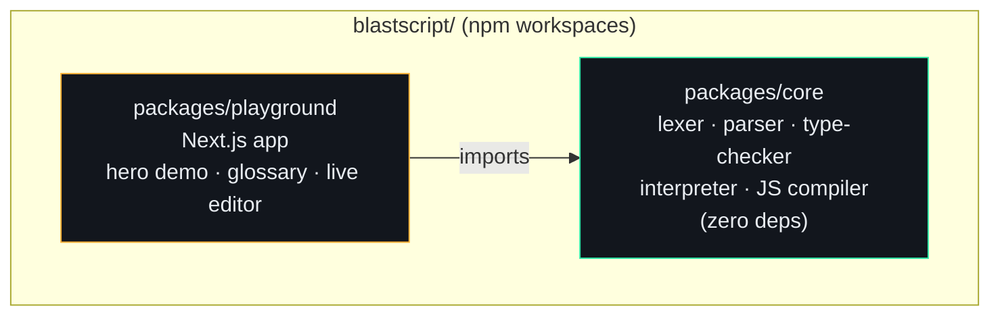
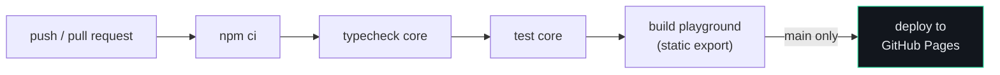

# BlastScript
[](https://github.com/Onyx2006/BlastScript/actions/workflows/ci-cd.yml)
[](https://onyx2006.github.io/BlastScript/)
[](#license)

A small, ambitious programming language with an arcade shooter's
vocabulary — `spawn`, `hit`, `score`, `loot` — plus gradual types,
closures, recursion, and a compiler down to JavaScript. This repo has
two packages: the language itself, and a Next.js playground that runs
it live in the browser.

**[Try it live →](https://onyx2006.github.io/BlastScript/)**

```blast
weapon factorial(n: num) => num {
  aim (n <= 1) { score 1 }
  score n * factorial(n - 1)
}

shout("5! =", factorial(5))
```

## Repo layout


- **[`packages/core`](packages/core/README.md)** — the language
  implementation. Fully documented, fully tested, no runtime
  dependencies. Read this first if you want to understand how
  BlastScript actually works.
- **[`packages/playground`](packages/playground/README.md)** — the
  website. Runs `@blastscript/core` entirely client-side; nothing is
  executed on a server.
- **[`.github/workflows`](.github/workflows/ci-cd.yml)** — the CI/CD
  pipeline that tests the language and publishes the playground
  (see [CI/CD](#cicd) below).

## Quick start
```bash
npm install
npm run test:core          # run the language's test suite (no network needed)
npm run dev:playground      # start the website at localhost:3000
```

To produce the same static build that gets deployed:
```bash
npm run build:playground    # static export in packages/playground/out
```

## Language at a glance
| Category | Keywords |
|---|---|
| Declarations | `spawn` (mutable), `loadout` (constant), `weapon` (function) |
| Control flow | `aim`/`else` (if), `respawn` (while), `wave` (for), `flee` (break), `reload` (continue), `score` (return) |
| I/O & modules | `shout` (print), `loot` (import) |
| Literals | `alive`/`dead` (bool), `void` (null) |
| Types (optional) | `: num`, `: str`, `: bool`, `: arr`, `: fn`, `: any`, `=> <type>` |

See [`packages/core/README.md`](packages/core/README.md) for the full
keyword reference, the pipeline diagram, and how closures and control
flow are implemented internally.

## CI/CD
Every pull request and every push to `main` runs the pipeline in
[`ci-cd.yml`](.github/workflows/ci-cd.yml). Pushes to `main` that pass
all checks are deployed automatically to GitHub Pages.



| Stage | What it does |
|---|---|
| Typecheck | `tsc --noEmit` on `packages/core` |
| Test | Runs the language test suite (`npm run test:core`); fails the build on any failing test |
| Build | `next build` with `output: "export"`, producing plain HTML/JS/CSS |
| Deploy | Uploads the export as a Pages artifact and publishes it with `actions/deploy-pages` (skipped on pull requests) |

**How the static export works.** The playground has no server-side
code, so Next.js exports it as static files. GitHub Pages serves
project sites under `/<repo-name>/`, so the workflow sets
`NEXT_PUBLIC_BASE_PATH=/BlastScript` at build time. Locally the
variable is empty, so `npm run dev:playground` is unaffected.

**One-time setup** for a fork: in the repository go to
*Settings → Pages → Build and deployment* and set the source to
**GitHub Actions**. If you use a custom domain or a `<user>.github.io`
repository, set `NEXT_PUBLIC_BASE_PATH` to an empty value in the
workflow.

## Status
This is a young, from-scratch language — expect rough edges. The
interpreter and compiler agree on every example in
`packages/core/examples/` and in the test suite
(`packages/core/src/test/run.ts`), but the type checker is intentionally
minimal (structural, no generics, no union types yet).

## License
MIT