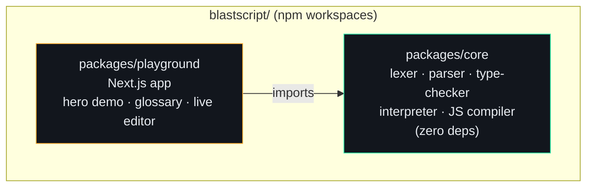

# BlastScript

A small, ambitious programming language with an arcade shooter's
vocabulary — `spawn`, `hit`, `score`, `loot` — plus gradual types,
closures, recursion, and a compiler down to JavaScript. This repo has
two packages: the language itself, and a Next.js playground that runs
it live in the browser.

```blast
weapon factorial(n: num) => num {
  aim (n <= 1) { score 1 }
  score n * factorial(n - 1)
}

shout("5! =", factorial(5))
```

## Repo layout



- **[`packages/core`](packages/core/README.md)** — the language
  implementation. Fully documented, fully tested, no runtime
  dependencies. Read this first if you want to understand how
  BlastScript actually works.
- **[`packages/playground`](packages/playground/README.md)** — the
  website. Runs `@blastscript/core` entirely client-side; nothing is
  executed on a server.

## Quick start

```bash
npm install
npm run test:core          # run the language's test suite (no network needed)
npm run dev:playground      # start the website at localhost:3000
```

## Language at a glance

| Category | Keywords |
|---|---|
| Declarations | `spawn` (mutable), `loadout` (constant), `weapon` (function) |
| Control flow | `aim`/`else` (if), `respawn` (while), `wave` (for), `flee` (break), `reload` (continue), `score` (return) |
| I/O & modules | `shout` (print), `loot` (import) |
| Literals | `alive`/`dead` (bool), `void` (null) |
| Types (optional) | `: num`, `: str`, `: bool`, `: arr`, `: fn`, `: any`, `=> <type>` |

See [`packages/core/README.md`](packages/core/README.md) for the full
keyword reference, the pipeline diagram, and how closures and control
flow are implemented internally.

## Status

This is a young, from-scratch language — expect rough edges. The
interpreter and compiler agree on every example in
`packages/core/examples/` and in the test suite
(`packages/core/src/test/run.ts`), but the type checker is intentionally
minimal (structural, no generics, no union types yet).

## License

MIT

# HITSCAN
> A tiny, typed, closures-included programming language for people who'd
> rather be fragging than filing bug reports.
Status: in development — see commit history for the build log.
 
## What is this
HITSCAN is a small interpreted language with a shooter-flavored vocabulary
(`spawn`, `loadout`, `frag`, `wave`, `respawn`) sitting on top of a very
ordinary, very real language core: a hand-written lexer, a recursive-descent
parser, a tree-walking interpreter with lexical closures, runtime type
checking, and a transpiler down to JavaScript.
 
It ships with a web playground (Next.js + Monaco) where you can write
HITSCAN in the browser, run it, and watch the parser build your AST live.
 
More docs land as the project does. Full write-up coming in
[`docs/LANGUAGE_SPEC.md`](./docs/LANGUAGE_SPEC.md).