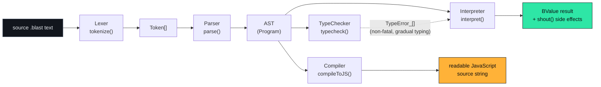

# @blastscript/core

The language implementation: lexer → parser → type-checker → interpreter,
plus a small AST-to-JavaScript compiler. Zero runtime dependencies — this
package is plain TypeScript, so it runs identically in Node and in the
browser (the playground imports it directly).

## Pipeline



Type errors don't block execution — BlastScript is **gradually typed**.
`typecheck()` returns a list of diagnostics; the host (CLI, playground,
tests) decides whether to surface them as warnings or hard-stop.

## Why the name is "gamer syntax"

Every keyword maps 1:1 to something in a top-down arcade shooter. The
mapping is deliberate, not decorative — once you know the game, the syntax
reads itself:

| BlastScript | Meaning              | Conventional equivalent |
|-------------|----------------------|--------------------------|
| `spawn x = 1` | mutable declaration | `let x = 1` |
| `loadout x = 1` | constant declaration | `const x = 1` |
| `weapon f(a, b) { ... }` | function declaration | `function f(a, b) { ... }` |
| `hit f(a, b)` | call (statement-level sugar) | `f(a, b);` |
| `score expr` | return | `return expr;` |
| `aim (cond) { } else { }` | if / else | `if (cond) { } else { }` |
| `respawn (cond) { }` | while loop | `while (cond) { }` |
| `wave (init; cond; step) { }` | for loop | `for (init; cond; step) { }` |
| `flee` | break | `break;` |
| `reload` | continue | `continue;` |
| `shout(...)` | print | `console.log(...)` |
| `loot "mod"` / `loot { a, b } "mod"` | import | `import ... from "mod"` |
| `alive` / `dead` | boolean `true` / `false` | `true` / `false` |
| `void` | null | `null` |

Type annotations (optional, gradual): `: num`, `: str`, `: bool`, `: arr`,
`: fn`, `: any`, and `=> <type>` for a weapon's return type.

```
weapon factorial(n: num) => num {
  aim (n <= 1) { score 1 }
  score n * factorial(n - 1)
}
```

**Reserved words note:** every keyword in the table above (plus the type
names `num/str/bool/arr/fn/any`) is reserved and cannot be used as an
identifier — `spawn score = 0` will not parse, because `score` is the
return keyword. See `examples/hello-arena.blast` for a program written
around this on purpose.

## Closures

Functions (`weapon`) close over their defining environment, not just their
arguments — `examples/closures.blast` demonstrates a counter factory:

```
weapon makeCounter(start: num) {
  spawn ammo = start
  weapon fire() {
    ammo = ammo + 1
    score ammo
  }
  score fire
}

spawn counter = makeCounter(0)
shout(counter())   // 1
shout(counter())   // 2
```

Internally, `Environment` is a linked chain of scopes
(`packages/core/src/interpreter.ts`); a `WeaponDecl` captures a reference to
the `Environment` active at definition time, and every call creates a new
child scope off that captured chain — the standard recipe for lexical
closures in a tree-walking interpreter.

## Control flow, implemented as exceptions

`score`, `flee`, and `reload` are implemented as internal "signal" classes
(`ScoreSignal`, `FleeSignal`, `ReloadSignal`) thrown from `execStmt` and
caught at the nearest function call / loop boundary. This keeps the
evaluator's control-flow handling in one place instead of threading a
"did we return?" flag through every recursive call.

## API

```ts
import { run } from "@blastscript/core";

const { value, typeErrors } = run(source, {
  onShout: (values) => console.log(...values),
  onStep: (node) => { /* called before every statement — used for the
                          playground's live combat log */ },
});
```

Lower-level pieces (`tokenize`, `parse`, `typecheck`, `interpret`,
`compileToJS`) are all exported individually from `src/index.ts` for
anyone who wants to hook in at a specific stage — e.g. the playground
calls `tokenize` + `parse` on every keystroke for instant syntax
highlighting/error markers, and only runs `interpret` on demand.

## Tests

`src/test/run.ts` is a small, dependency-free assertion runner (no test
framework — this is a from-scratch language, so the test harness is
from-scratch too) covering arithmetic, conditionals, both loop forms,
`flee`/`reload`, closures, recursion, `loadout` immutability, type-error
detection, array built-ins, and the JS compiler's output.

```bash
npm run test --workspace=packages/core
```

## Building

```bash
npm run build --workspace=packages/core
```

Emits declaration files + ES2020 JS to `dist/`, consumed by the playground.
